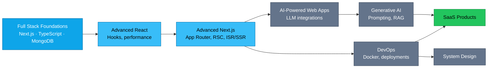

# Saad Kamal Shaikh

Full Stack Developer crafting fast, scalable web apps with **Next.js**, **TypeScript**, and **Node.js**.
Currently a college student, learning in public and building on the side.

---

## About

- 🎓 Currently a **college student** — this is my main focus right now, so progress on side projects is steady but slower
- Building full-stack web apps with **Next.js**, **TypeScript**, and **MongoDB**
- Delivered client projects end-to-end — planning, architecture, and deployment
- Currently sharpening **Advanced React** and **Next.js** (Server Components, App Router, performance patterns)
- Next up on my roadmap: **AI-powered projects** — LLM integrations and AI-assisted features
- Long-term interests: **SaaS products**, **AI-powered apps**, **Generative AI**, and **DevOps** (Docker, containerization)
- Based in Karachi, Pakistan

---

## Tech Stack

<table>
<tr>
<td><strong>Frontend</strong></td>
<td></td>
</tr>
<tr>
<td><strong>Backend & Database</strong></td>
<td></td>
</tr>
<tr>
<td><strong>Tools</strong></td>
<td></td>
</tr>
</table>

---

## Projects

### [Fashion Stylized](https://github.com/The-Saadhere/Fashion-Stylized)
Full-stack eCommerce platform built for a client over 2 months — covering requirements, UI/UX planning, and architecture through to launch. Features secure authentication (NextAuth + Google Sign-In), OTP verification via Resend, real-time inventory management, and an admin dashboard for products, orders, and users.

`Next.js` `TypeScript` `Zustand` `Zod` `MongoDB` `NextAuth` `Tailwind CSS`

---

### [MiniLink](https://github.com/The-Saadhere/MiniLink)
Link shortening service with click tracking and per-link analytics. Built with **Node.js**, **Next.js**, and **MongoDB**.

`Node.js` `Next.js` `MongoDB`

---

### [Vido](https://github.com/The-Saadhere/Vido)
Video streaming platform with secure authentication, video uploads, and automatic thumbnail generation.

`Next.js` `Node.js` `MongoDB`

---

## GitHub Stats

---

## Currently Learning

| Topic | Focus | Status |
|---|---|---|
| Advanced React | Hooks patterns, performance, component architecture | 🔵 In progress |
| Advanced Next.js | App Router, Server Components, ISR/SSR | 🔵 In progress |
| AI-Powered Web Apps | LLM integrations, AI-assisted features in Next.js apps | ⏳ Up next |
| Generative AI | Prompting, RAG basics, AI product building | ⏳ Up next |
| DevOps | Docker, containerization, deployment workflows | ⏳ Up next |
| System Design | Load balancers, DB sharding, CDN | 📌 Longer-term |

> Currently balancing college as my main priority, so I'm moving through this list steadily rather than fast — but SaaS, AI-powered products, and Gen AI are where I'm headed.

---

## Contact

[saadkamaldev@gmail.com](mailto:saadkamaldev@gmail.com) · [LinkedIn](https://www.linkedin.com/in/the-saadhere) · [Portfolio](https://saadkamal.vercel.app/)
